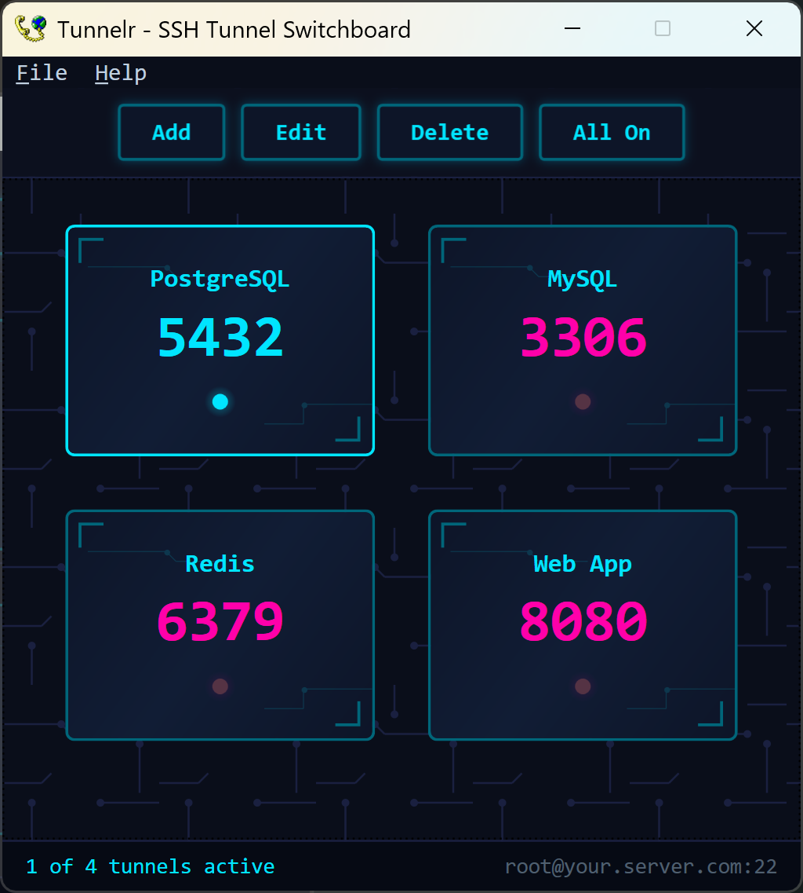

# Tunnelr 2

A Windows tray app for SSH local port forwarding. Click a neon card to toggle its tunnel. Hover for the endpoint, destination and state. Right-click to copy the endpoint or inspect SSH output.



## Install or build

Download **tunnelr.exe** for Windows x64, or choose **tunnelr_minimal.exe** if the x64 .NET 7 Desktop Runtime is already installed. [GitHub releases](https://github.com/jordankzf/tunnelr/releases/latest)

With the .NET 7 SDK installed on Windows, run the following from this repository.

```powershell
.\Install-Tunnelr.ps1
```

Launch **%LOCALAPPDATA%\Programs\Tunnelr\tunnelr.exe**. The installer bundles the runtime and keeps an existing login entry pointing to the installed copy. Exit Tunnelr from its tray menu before upgrading. Windows OpenSSH Client must be available as **ssh.exe**. Set up key-based authentication or load your key into the SSH agent.

For development, run **dotnet run**. All builds use the same per-user settings. Opening a second v2 instance brings the running window forward.

## Use

Choose **File → Edit server profile** to set the server, user and SSH port. Add tunnels with an optional group name, then filter by group to connect a set together. A blank remote port uses the local port. Each forward binds to IPv4 loopback and targets **localhost** on the SSH server. Profiles have independent tunnels. Switching the displayed profile keeps existing forwards running. Editing its SSH destination stops that profile’s forwards.

**Connecting** means OpenSSH is starting or authenticating. **Listening** means it established the local forward. The application behind the remote port can still be offline. Use **right-click → SSH output** for recent diagnostics. For a new host, choose **Verify host** and compare the fingerprint in the OpenSSH prompt with the server administrator’s fingerprint. Accept it there and connect again. A changed host key blocks the connection.

Enable **Reconnect after sleep or network loss** in a profile to resume requested tunnels after waking and retry transient network failures. **Off** cancels retries. Closing the window hides it in the tray. **Exit Tunnelr** stops its SSH processes.

## Settings and recovery

Settings live in **%LOCALAPPDATA%\Tunnelr\tunnels.json**. Every successful replacement keeps the preceding file as **tunnels.json.previous**. Use **File → Restore previous save** to preview it. **Import configuration** also reads v1 files, including copies beside old executables. Review every server, nickname and port before accepting. Import replaces the full configuration and stops current forwards.

On first launch without per-user settings, v2 previews a legacy file beside its executable. If the current settings cannot be parsed, startup offers a file picker for recovery.

Made by @jordankzf. See [LICENSE](LICENSE).
